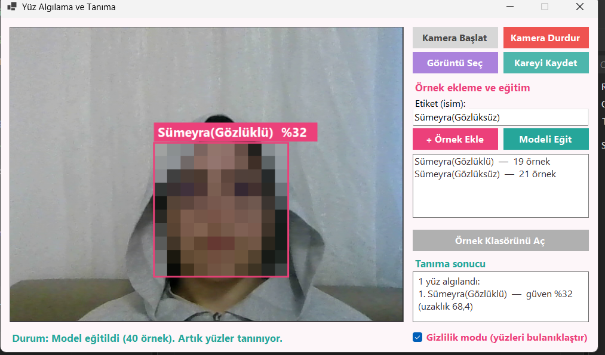
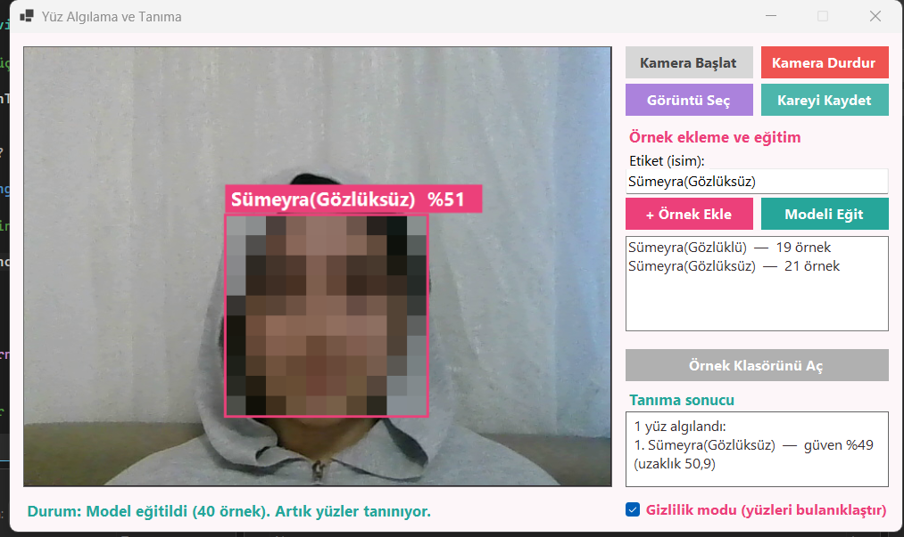

# YMH219 - Face Recognition

Nesne Tabanlı Programlama (YMH219) dersi kapsamında geliştirilmiş, **OpenCV** tabanlı bir yüz algılama ve tanıma uygulamasıdır. Kameradan veya seçilen bir resimden görüntü alır, yüzleri dikdörtgenle işaretler ve kullanıcının oluşturduğu küçük yerel örnek kümesiyle yüzün kime ait olduğunu tahmin eder.

> Bu çalışma yalnızca ders kapsamında, yerel ve gönüllü örneklerle kullanılmak üzere hazırlanmıştır. Uygulama görüntüleri hiçbir yere göndermez; örnekler yalnızca kullanıcının kendi bilgisayarında saklanır.

## Kullanılan Teknolojiler

| Teknoloji | Kullanım amacı |
|---|---|
| C# / .NET 10, Windows Forms | Uygulama ve arayüz |
| `OpenCvSharp4` (NuGet) | OpenCV'nin C# kütüphanesi |
| `OpenCvSharp4.runtime.win` (NuGet) | OpenCV'nin Windows yerel dosyaları |
| `OpenCvSharp4.Extensions` (NuGet) | OpenCV görüntüsünü `Bitmap`'e çevirme |
| Haar Cascade (`haarcascade_frontalface_default.xml`) | Yüz algılama modeli ([OpenCV deposu](https://github.com/opencv/opencv/tree/4.x/data/haarcascades)) |
| LBPH (Local Binary Patterns Histograms) | Yüz tanıma yöntemi (`OpenCvSharp.Face`) |

## Kurulum ve Çalıştırma

1. Depoyu klonlayın:
   ```bash
   git clone https://github.com/Sumeyraadiyaman/YMH219-FaceRecognition.git
   ```
2. `YMH219-FaceRecognition.slnx` dosyasını Visual Studio ile açın. NuGet paketleri otomatik olarak geri yüklenir.
3. `F5` ile çalıştırın.

> Yüz algılama modeli depoda `Models/` klasöründedir ve derleme sırasında otomatik olarak çıktı klasörüne kopyalanır.

## Kullanım

1. **Kamera Başlat**'a basın (veya **Görüntü Seç** ile bir resim açın). Yüzler dikdörtgenle işaretlenir.
2. **Etiket** kutusuna bir isim yazın, kameraya bakarken **Örnek Ekle**'ye birkaç kez basın (etiket başına 10+ örnek önerilir; başınızı hafifçe çevirerek farklı açılar ekleyin).
3. En az **iki farklı etiket** için örnek ekleyin. Örneğin izin veren bir arkadaş, ya da kendi yüzünüzün farklı halleri (`Sümeyra`, `Sümeyra-gözlük`).
4. **Modeli Eğit**'e basın. Bundan sonra yüzlerin üzerinde tahmin edilen isim ve güven yüzdesi görünür.

Örnekler `Belgeler\YMH219-FaceRecognition\Yuzler\<etiket>\` klasöründe saklanır ve uygulama yeniden açıldığında model otomatik eğitilir.

## Özellikler

- **Kamera Başlat / Durdur** ve **Görüntü Seç** işlevleri
- Görüntü uygulama içinde (`PictureBox`) gösterilir.
- **Yüz algılama:** Algılanan her yüz dikdörtgenle işaretlenir.
- **Birden fazla yüzü aynı karede işaretleme (ek özellik)**
- **Tanıma:** Tahmin edilen etiket ve güven skoru hem görüntü üzerinde hem de sonuç kutusunda gösterilir.
  - Pembe: tanınan kişi · Kırmızı: "Bilinmiyor" · Lavanta: model henüz eğitilmedi
- **Basit eğitim/veri ekleme ekranı (ek özellik):** Etiket yazıp örnek ekleme, örnek sayılarını görme, modeli eğitme
- **Kareyi Kaydet (ek özellik):** İşaretlenmiş görüntüyü `Belgeler\YMH219-FaceRecognition\Kayitlar` klasörüne kaydeder.
- **Hata yönetimi:** Kamera açılamazsa, bağlantısı koparsa, model dosyası bulunamazsa veya görüntü okunamazsa uygulama kapanmaz; kullanıcıya anlaşılır mesaj gösterilir.

## Sınıf Yapısı

| Sınıf | Sorumluluğu |
|---|---|
| `CameraService` | Kameradan arka planda kare okur, olay ile bildirir |
| `FaceDetector` | Haar Cascade ile görüntüdeki yüzlerin yerini bulur |
| `FaceRecognizerService` | LBPH modelini eğitir ve yüzün etiketini tahmin eder |
| `FaceDataset` | Yerel örnekleri etiket klasörlerinde saklar ve okur |
| `FaceAnalyzer` | Algılama + tanımayı birleştirir; bir karedeki tüm yüzleri sonuçlarıyla döndürür |
| `FaceImage` | Yüz bölgesini hazırlama (100x100, gri, ışık dengeleme), görüntü okuma/yazma |
| `MainForm` | Arayüz, çizim ve kullanıcı etkileşimi |

## Teknik Notlar

- Kamera okuması arka plan iş parçacığında yapılır; arayüz `BeginInvoke` ile güncellenir. Önceki kare ekrana basılmadan yeni kare gelirse atlanır, böylece kuyruk birikmez.
- Eğitim `Task.Run` ile arka planda yapılır; tanıma modeli eğitim ve tahmin sırasında `lock` ile korunur.
- **Güven skoru:** LBPH bir "uzaklık" değeri verir (küçük = daha benzer). Arayüzde bu değer yaklaşık olarak `%(100 - uzaklık)` şeklinde gösterilir. Uzaklık 80'in üzerindeyse sonuç "Bilinmiyor" kabul edilir.
- OpenCV'nin dosya okuma/yazma fonksiyonları Türkçe karakterli yollarda çalışmadığı için görüntüler `File.ReadAllBytes` + `Cv2.ImDecode` ile okunur.
- Etiketlerin üzerindeki yazılar Türkçe karakterleri gösterebilmek için OpenCV yerine GDI+ (`Graphics.DrawString`) ile çizilir.

## Ekran Görüntüleri

**Yüz algılama ve tanıma**



**Örnek ekleme ve eğitim**



## Bilinen Sınırlamalar / Geliştirme Notları

- Haar Cascade yöntemi önden bakan yüzlerde iyi çalışır; yandan, çok karanlık veya bulanık yüzleri kaçırabilir.
- LBPH küçük veri kümeleri için uygundur ancak ışık değişimlerine duyarlıdır; doğruluk örnek sayısı ve çeşitliliğiyle artar.
- Kamera indeksi sabit olarak 0'dır (bilgisayarın varsayılan kamerası).
- Geliştirme fikri: Daha yüksek doğruluk için DNN tabanlı yüz algılama (ör. YuNet) kullanmak.

## Öğrenci

- **Ad Soyad:** Sümeyra Adıyaman
- **Öğrenci No:** BURAYA_NUMARANI_YAZ
